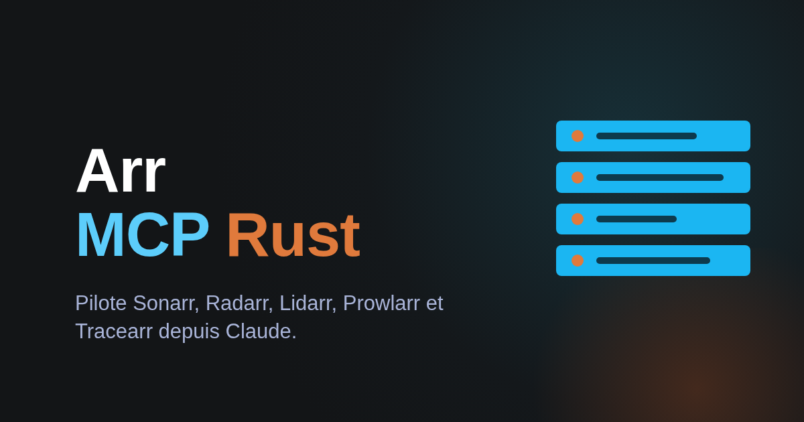

Arr MCP Rust est un serveur MCP écrit en Rust qui laisse Claude (ou tout client MCP) piloter Sonarr, Radarr, Lidarr, Prowlarr et Tracearr : un seul binaire statique, ou une image Docker.
Il expose 22 outils `arr_*` pour lire la bibliothèque, la file de téléchargement, l'historique et les releases, avec un mode test qui ne contacte rien de réel.
Il est fermé par défaut : lecture seule tant que les écritures et les suppressions ne sont pas activées, confirmation humaine pour les actions destructives, secrets masqués.
Il inclut une skill complète pour les agents. Projet sous licence MIT.
